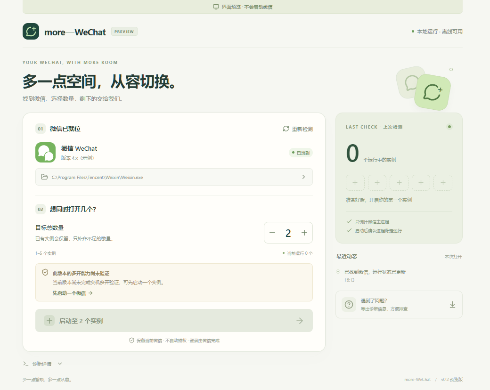

# more-WeChat

**微信多开启动与诊断工具 · Windows / macOS · v0.2.1**

[](https://github.com/wuyouning/more-WeChat/actions/workflows/desktop.yml?query=branch%3Amaster)

[下载安装](#下载与安装) · [兼容情况](#兼容情况) · [本地开发](#本地开发) · [问题反馈](#问题反馈)

自动找到微信，设置目标数量，查看启动结果。已有实例会保留，只补齐不足的数量，登录操作在微信窗口中完成。



## 功能

- **自动识别微信**：检查常用安装位置和运行进程，也可以手动选择中文或带空格的安装路径。
- **按目标数量启动**：支持 1–5 个实例，默认 2 个；已有数量达标就不新增，也不会关闭已有微信。
- **看得懂的结果**：检测新主进程是否持续运行，区分启动成功、部分成功、权限不足和启动后退出。
- **明确的兼容状态**：按微信构建、系统和架构显示已验证或未验证，避免把辅助进程算成多个微信。
- **本地诊断与设置**：记住安装位置和数量，按需导出隐藏用户目录用户名的诊断报告。

## 下载与安装

从 [v0.2.1 发布页](https://github.com/wuyouning/more-WeChat/releases/tag/v0.2.1) 下载安装包，**无需登录 GitHub**。此版本修复 Mac 微信自动检测失败、副本启动崩溃与启动结果误报；Intel 安装包已完成 Developer ID 签名和 Apple 公证。完整更新说明见 [版本记录](CHANGELOG.md)。

| 平台 | 下载安装包 | 安装方法 |
| --- | --- | --- |
| Windows x64 | [Windows 安装包](https://github.com/wuyouning/more-WeChat/releases/download/v0.2.1/more-WeChat_0.2.1_x64-setup.exe) | 运行安装器，按当前用户安装 |
| Mac Apple Silicon（M 系列） | [Mac arm64 安装包](https://github.com/wuyouning/more-WeChat/releases/download/v0.2.1/more-WeChat_0.2.1_aarch64.dmg) | 打开 DMG，将应用拖入 Applications；此包尚未公证，微信兼容性待实机验证 |
| Mac Intel | [Mac x64 安装包（已签名公证）](https://github.com/wuyouning/more-WeChat/releases/download/v0.2.1/more-WeChat_0.2.1_x64-notarized.dmg) | 打开 DMG，将应用拖入 Applications，替换旧版本 |

后续正式版本可从 [最新发布页](https://github.com/wuyouning/more-WeChat/releases/latest) 获取；开发预览包仍在 [主分支构建页面](https://github.com/wuyouning/more-WeChat/actions/workflows/desktop.yml?query=branch%3Amaster) 的 **Artifacts** 中，需要登录 GitHub。

Windows 需要 WebView2；系统没有安装时，安装器会下载该运行时，应用运行过程不联网。Windows 包未作发行者签名；Mac Apple Silicon 包为 ad-hoc 签名、未公证，系统可能限制运行。Intel 发布包已完成签名公证，并通过下表所列组合的人工验收。发布页提供 SHA256 校验文件。

未公证的 Mac 预览包或 Apple Silicon 包首次打开若被系统拦截，确认包来自本仓库后，可在“系统设置 → 隐私与安全”中对此应用选择“仍要打开”。检测微信不需要授予辅助功能或完全磁盘访问。分发签名与原版微信签名校验的区别见 [Mac 首次打开与签名排查](docs/macos-adapter.md#启动器首次打开与签名排查)。旧包若在工具内误报微信原版签名失败，请更新到 v0.2.1。

## 兼容情况

**Windows 本机组合已通过双账号登录与消息收发验收，Intel Mac 本机组合已通过四开场景下的登录与消息收发验收。** 已验证环境见下表。macOS 界面目前仍使用通用“版本未验证”提示，未按本次人工记录自动标记具体构建；其他系统组合不能据此视为已验证。“主进程已运行”本身不表示账号已登录。

| 平台 | 当前实现与验证 | 多开策略 |
| --- | --- | --- |
| Windows 10/11 x64 | **已验证：Windows 11 x64（10.0.22631）/ 微信 4.1.15.13，维护者确认两个不同账号同时登录且正常收发消息**；截图与通话待验 | EXE、DLL 指纹和系统/架构均匹配才显示已验证；同构建其他系统可尝试普通启动；其他微信构建暂仅支持单开与诊断 |
| macOS 13+ Apple Silicon / Intel | **已人工验证：Intel / macOS 26.3.1 (a)（25D771280a）/ 微信 4.1.13 / more-WeChat v0.2.1，四个独立窗口，登录与消息收发正常**；截图、通话及 Apple Silicon 实机待验 | 给符合条件的微信 4.x 创建独立副本并本地签名 |

完整测试边界、构建指纹及验收步骤见 [兼容记录](docs/compatibility.md)。Windows 互斥锁适配只接受内置的具体构建和准确名称；当前没有启用远程句柄关闭规则，不会拿其他锁来试错。

## 使用方法

1. 打开 more-WeChat，确认识别到的微信路径和版本；未找到时点击路径栏手动选择。
2. 设置目标总数量（1–5，默认 2），点击启动。未适配多开的 Windows 构建可以先选择 1。
3. 查看启动结果，再到微信窗口中登录账号。“启动成功”表示检测到主进程稳定运行。
4. 遇到问题时点击“重新检测”或“导出诊断信息”，按错误说明排查。

例如：已有 1 个微信、目标设为 2，只会补开 1 个；已有 3 个、目标设为 2，不会关闭任何实例。运行数量是上次检测结果，点击“重新检测”可刷新。

旧的 `.bat`、`.sh`、`.command` 文件现在是桌面应用入口。请将脚本一起下载；仅有 `.command` 时还需要同目录的 `.sh`。Mac 脚本可用 `bash more-wechat.sh` 运行；不再直接执行 2020 年的多开命令。

## 本地开发

需要 Node.js 22.12+、pnpm 10.28、Rust 1.93+。Windows 还需要 Visual Studio C++ Build Tools 和 WebView2；Mac 需要 Xcode Command Line Tools。具体依赖见 [Tauri 环境要求](https://v2.tauri.app/start/prerequisites/)。

```sh
pnpm install --frozen-lockfile
pnpm tauri dev
```

`pnpm dev` 只打开前端开发服务器，明确显示“界面预览 · 不会启动微信”，使用演示数据；真实系统接口只在桌面应用中运行。原生接口错误不会自动切换成演示成功。

```sh
pnpm test
pnpm test:browser
pnpm build
cargo test --locked --manifest-path src-tauri/Cargo.toml --lib
cargo clippy --locked --manifest-path src-tauri/Cargo.toml --all-targets -- -D warnings

# 在 Windows 上打包
pnpm tauri build --bundles nsis --ci
# 在 Mac 上打包（按架构添加 --target）
pnpm tauri build --bundles dmg --ci
```

安装包位于 `src-tauri/target/release/bundle/`。CI 为 Windows x64、Mac arm64 和 Mac x64 分别编译并上传预览包，不自动发布正式 Release。

Windows 原生集成检查：先运行 `pnpm dev`，再执行 `cargo build --manifest-path src-tauri/Cargo.toml` 和 `pnpm test:native`。测试只给自建调试应用启用本机 WebView2 调试端口，检查真实 IPC、无效输入、设置持久化、达标不新增、诊断导出及原生界面；不会操作微信登录界面。生产构建不启用该端口。

本次 macOS 修复已通过 31 项 Rust 测试与 Clippy，并完成本机 1 → 2、2 → 4 实例启动检查，以及目标 4 重复启动不新增实例的检查。此前已通过 9 项界面测试、Windows 21 项 Rust 测试、1 项显式副本签名测试及三个平台安装包构建。架构与原生接口见 [实现说明](docs/architecture.md)，微信实机结论见 [兼容记录](docs/compatibility.md)。

## 设置与数据

- 设置保存在系统应用数据目录下的 `io.github.wuyouning.more-wechat/settings.json`，包含微信路径和目标数量。
- Mac 受管理副本在 `~/Applications/more-WeChat/slot-N/WeChat.app`；原版升级后，仅在下次启动相应停止副本时刷新。稳定 Bundle ID 用于保留其容器身份，工具不迁移或删除聊天数据。详见 [Mac 实现与限制](docs/macos-adapter.md)。
- 工具不读取聊天内容、不自动登录、不上传日志、不自动提权、不结束现有微信。关闭工具后，微信继续运行。
- 诊断记录在内存中保留本次打开的最近 200 条，手动导出 JSON 才写盘。导出隐藏用户目录中的用户名；其他自定义路径仍可能包含个人信息，请检查后再分享。

## 问题反馈

遇到问题请使用 [启动问题模板](https://github.com/wuyouning/more-WeChat/issues/new?template=bug_report.yml)，附上系统版本和架构、微信版本、启动前数量、目标数量、错误提示，以及检查过的诊断信息。请勿附上登录二维码、账号凭据或聊天内容。

也欢迎反馈其他系统、架构和微信版本的测试结果：注明两个不同账号是否能同时登录、是否能正常收发消息。兼容表会按实际验证范围更新。

## 关于项目

这个项目从 2020 年解决个人刚需的小脚本开始。图形版继续保持“小工具”的边界：首版做好启动与诊断，实例备注、窗口切换和自动更新留待后续。项目与腾讯无隶属关系。
